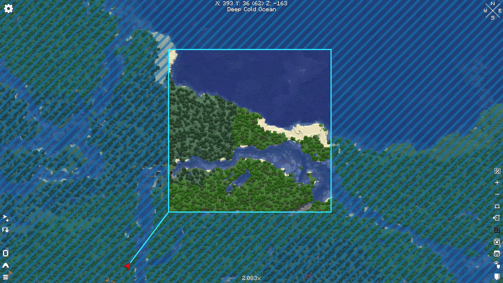
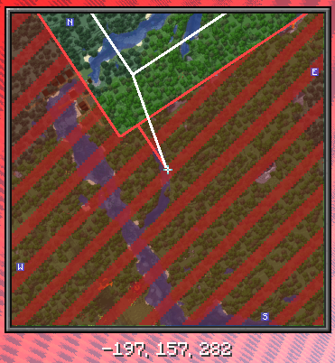
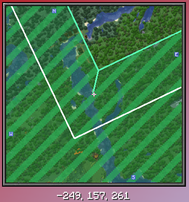
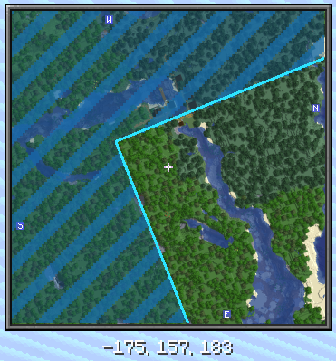
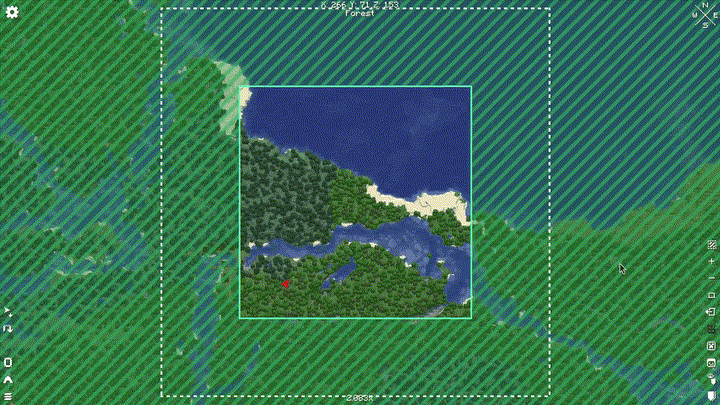

# Shuu's Xaero World Border



A simple mod that adds support for viewing the world border through xaero's world map and minimap mod.

The map changes color depending on if the border is stationary, growing, or shrinking:

  

You may also be able to enable or disable the visibility of the overlay via the world map mod. Note that when you turn it off in the world map, it also turns it off in the minimap!



# FAQ

## Do I need both the minimap mod and world map, or can I just have one or the other?

You can have both, one of either, or even none of them! This mod entirely detects if the mod is available, and if so it injects the necessary mixin to add support.

## What version of xaero's minimap and world map does it support?

At the time of writing, the mod supports minimap >26.6.0, and worldmap >1.47.0. If future variants are broken, try the direct versions I mentioned.
<!-- xaero_minimap_mod_version=26.6.0
xaero_worldmap_mod_version=1.47.0 -->


# Developer Notes

Fabric is a Bring Your Own requires you to bring the xaero mods and put them in the mod folder, where you have to install the mod yourself. For forge, it installs the mod itself. I don't know why they won't play nicely together, but they don't.

## Running from VS Code

`.vscode/launch.json` and `.vscode/tasks.json` are written by hand, not generated.

**Debugging (F5, Run and Debug view):**

| Configuration | What it does |
| --- | --- |
| `Forge Client` / `Forge Server` / `Forge Data` | Builds `:forge:classes`, then launches the game directly with the debugger attached. |
| `Fabric Client (debug)` / `Fabric Server (debug)` | Runs `:fabric:runClient -Pdebug` as a background task, which starts the game suspended on port 5005, then attaches to it. |

**Just running, no debugger:** use the `fabric: runClient` / `fabric: runServer` tasks from Terminal > Run Task. Forge has no plain task variant because its F5 configuration is already a direct launch.

### Why the Forge configurations are hand written

ModDevGradle's own VS Code generator points `MOD_CLASSES` at the Eclipse/JDT output folder, `forge/bin/main`. The Java extension copies `src/main/resources` into that folder verbatim, so `META-INF/mods.toml` still holds its `${mod_id}` placeholders and Forge dies during mod discovery with:

```
com.electronwill.nightconfig.core.io.ParsingException: Invalid bare key: ${mod_id}
```

`disableIdeRun()` in `forge/build.gradle` switches that generator off, and `launch.json` points at Gradle's processed output instead - the same folders the IntelliJ run configs use:

- `forge/build/classes/java/main` - compiled classes
- `forge/build/resources/main` - resources with the placeholders expanded

Two things worth knowing:

- The generator rewrites `.vscode/launch.json` whenever VS Code syncs the Gradle project. It keeps configurations it did not create, but it strips `//` comments and reformats the file, so explanations live here rather than in `launch.json`.
- `MOD_CLASSES` entries are separated by `File.pathSeparator`: `:` on Linux/macOS, `;` on Windows. These configurations use `:`.

### Why Fabric goes through Gradle

Fabric Loom has no VS Code integration, so there is no generated argument file to reuse. The Gradle task owns the classpath and Loom's dev JVM arguments; `-Pdebug` (see `fabric/build.gradle`) adds the JDWP agent and `launch.json` attaches to it.

# Note on Generative AI

**Local artificial intelligence** was used in the making of the mod to help speed up the process of reverse engineering, and code generation. A **human** made the art, mod design, and code organization/design/cleanup. Real effort was put into the production of this mod. Users deserve to know what went into making a project.